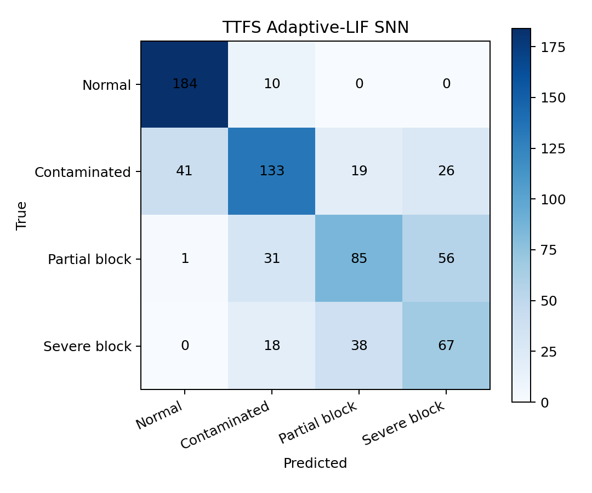

# NeuroPipe: Sparse Population TTFS and Adaptive-LIF for Pipeline Monitoring

NeuroPipe is an experimental spiking-neural-network (SNN) framework for classifying pipeline conditions at the sensor edge. It combines sparse population Time-to-First-Spike (TTFS) encoding with Adaptive Leaky Integrate-and-Fire (ALIF) neurons, with the longer-term goal of efficient, low-power pipeline anomaly monitoring.

**Project status:** the current repository is a research prototype built and evaluated using historical NEXUS sewer-testbed recordings. It is not yet a validated system operating on newly collected, independent real-world pipeline data. The next development phase is to adapt and validate the framework using fresh sensor recordings and, ultimately, a physical pipeline testbed.

The research design and evaluation discussed here are based on the accompanying NeuroPipe research document. The code and result files currently checked into this repository are not necessarily the exact final implementation or experiment configuration described in that document; the distinction is explained below.

## Research objective

The intended system receives sensor measurements and predicts one of several pipeline states. The current NEXUS task uses three inputs:

- Flow rate (Flow_L_min)
- Smoothed total dissolved solids (TDS_smooth)
- Smoothed turbidity (Turbidity_smooth)

The four historical NEXUS labels are:

| Label | Class |
|---:|---|
| 0 | Normal |
| 1 | Contaminated |
| 2 | Muddy water / partial blockage |
| 3 | Severe blockage |

The longer-term objective is to extend the approach beyond this historical sewer dataset to new recordings and other pipeline-monitoring scenarios, including leak detection. The pneumatic oil-and-gas testbed described in the research document is a proposed future setup, not a completed or validated hardware system.

## Model pipeline

The proposed NeuroPipe pipeline is:

1. **Sensor input:** one reading containing flow, TDS and turbidity.
2. **Preprocessing:** fit clipping/scaling parameters on training data only and apply the same transformation to validation and test data.
3. **Sparse population TTFS encoding:** represent each input feature using Gaussian receptive fields. Each receptive field can emit at most one spike, with response strength determining spike timing; a population threshold controls sparsity.
4. **Adaptive-LIF hidden layer:** integrate incoming spikes and adapt the firing threshold based on recent spiking activity.
5. **Readout:** a non-spiking leaky integrator produces class scores.
6. **Training:** use surrogate gradients and a classification loss to train the SNN.

The research document specifies eight receptive fields per feature, 20 simulation steps and a 64-neuron ALIF hidden layer for its reported experiment. These settings describe that experiment and should not be assumed to match every notebook or checkpoint currently in the repository.

## Repository contents

~~~text
NeuroPipe_Adaptive-LIF/
├── Training/
│   ├── NeuroPipe.ipynb
│   ├── ann_training.ipynb
│   ├── snn_training.ipynb
│   └── final_data.csv
├── raw_data/
│   ├── final_bloackage.txt
│   ├── muddy+soap_anomly.txt
│   ├── normal_baseline.txt
│   ├── preprocessing.ipynb
│   ├── soap_round_final.txt
│   └── soap_round_light.txt
└── results_neuropipe_adaptive/
    ├── NeuroPipe_adaptive_framework.ipynb
    ├── NeuroPipe_random_stratified_optimization.ipynb
    ├── classification_report.txt
    ├── confusion_matrix.png
    ├── metrics.json
    ├── training_history.csv
    └── ttfs_adaptive_lif.pt
~~~

## Existing data and results

### Historical NEXUS dataset

The research document describes 3,545 readings collected at 1 Hz from the earlier NEXUS sewer-monitoring testbed:

| Class | Number of readings |
|---|---:|
| Normal | 972 |
| Contaminated | 1,095 |
| Muddy / partial blockage | 863 |
| Severe blockage | 615 |
| **Total** | **3,545** |

These recordings are useful for developing the initial pipeline, comparing encoders and neuron models, and testing the training workflow. However, they do not represent multiple independent recording sessions for every class.

### Results in the current repository artifacts

The committed results_neuropipe_adaptive/metrics.json and classification report currently record the following evaluation:

| Metric | Recorded result |
|---|---:|
| Accuracy | 66.15% |
| Macro precision | 63.88% |
| Macro recall | 64.80% |
| Macro F1-score | 63.89% |
| Weighted F1-score | 65.68% |
| Mean spikes per sample | 23.14 |

Per-class results from the committed classification report:

| Class | Precision | Recall | F1-score |
|---|---:|---:|---:|
| Normal clean-water flow | 0.81 | 0.95 | 0.88 |
| Contaminated flow | 0.69 | 0.61 | 0.65 |
| Muddy water / partial blockage | 0.60 | 0.49 | 0.54 |
| Severe blockage | 0.45 | 0.54 | 0.49 |

### Results reported in the research document

The accompanying research document reports a separate, tuned experiment using repeated stratified random train/validation/test splits across five seeds. In that experiment, NeuroPipe reports **98.80 ± 1.00% accuracy** and **0.987 ± 0.010 macro-F1**. Those figures belong to the experiment described in the document; they are not the metrics currently stored in the repository's metrics.json.

Crucially, the document also audits the limitations of random row-level splitting. It reports that accuracy falls to **72.2% on held-out time blocks** and **60.8% on a held-out later stretch**. Nearby readings from the same recording can be highly similar, so random splits can give an optimistic estimate of performance on genuinely new recordings.

The document further notes that each class is represented by a single recording, making class and recording session difficult to separate. Therefore, neither the random-split results nor the current repository metrics should be presented as proof of generalisation to new sites, sessions, sensors or operating conditions.

## Development roadmap: from historical data to new real-world recordings

The main next step is not simply to increase the score on the existing dataset. It is to make the complete pipeline work reliably on fresh data that was not used during model development.

1. **Collect new recordings:** acquire multiple independent sessions for each pipeline condition, with sensor timestamps and consistent class labels.
2. **Define the sensor/data interface:** document sensor units, sampling rates, calibration, missing-value handling and the format expected by the preprocessing pipeline.
3. **Build a reproducible preprocessing path:** fit preprocessing parameters on training recordings only and apply them unchanged to validation and test recordings. Avoid leakage from rolling windows or overlapping temporal segments.
4. **Use recording-aware evaluation:** keep entire sessions or later chronological periods out of training. Do not rely only on random row-level splits.
5. **Revisit the input representation:** verify whether flow, TDS and turbidity are sufficient for the new use case. Add other channels only when they are actually measured and available at inference time.
6. **Retrain and compare models:** evaluate the SNN against suitable conventional baselines using the same recording-level splits and report per-class performance.
7. **Test robustness:** evaluate sensor noise, drift, missing readings and changes in operating conditions using held-out recordings.
8. **Move toward hardware validation:** only after offline validation, measure latency, memory, power and energy on the intended embedded platform.

For a leak-monitoring extension, the research document discusses a future pneumatic testbed with acoustic, pressure, vibration, temperature and flow sensing. This is a proposed direction; the hardware, data collection and real-world validation remain future work.

## Installation

Python 3.10+ is recommended. Create and activate a virtual environment, then install the core dependencies:

~~~bash
python -m venv .venv

# Windows
.venv\Scripts\activate

# Linux / macOS
source .venv/bin/activate

python -m pip install --upgrade pip
pip install numpy pandas scikit-learn matplotlib torch jupyter
~~~

For the extended adaptive-framework notebook, additional dependencies may be required:

~~~bash
pip install scipy PyWavelets
~~~

Install a PyTorch build appropriate for your CPU or CUDA setup from the [official PyTorch installation selector](https://pytorch.org/get-started/locally/).

## Training the current implementation

The Training/NeuroPipe.ipynb notebook contains the TTFS Adaptive-LIF training implementation. Its script-style entry point accepts the following arguments:

| Argument | Default | Description |
|---|---:|---|
| --data | Training/final_data.csv | Input CSV |
| --outdir | results_neuropipe_adaptive | Output directory |
| --epochs | 100 | Maximum training epochs |
| --batch-size | 64 | Mini-batch size |
| --hidden | 32 | Hidden-layer width |
| --timesteps | 20 | Simulation time steps |
| --lr | 0.001 | Learning rate |

If you extract the script from the notebook into a Python file named train_neuropipe.py, run:

~~~bash
python train_neuropipe.py --data Training/final_data.csv --outdir results_neuropipe_adaptive
~~~

Check the notebook's configured paths, expected CSV columns and preprocessing before running it on another dataset. The current defaults and implementation should be treated as the existing baseline, not as a finished ingestion pipeline for arbitrary live sensor data.

## Current limitations

- The checked-in training data and evaluation artifacts are based on historical NEXUS recordings.
- The current repository's recorded metrics differ from the tuned experiment reported in the research document; results must be attributed to the correct run.
- Random row-level splits can overestimate generalisation because neighbouring samples from a recording are similar.
- Multiple independent sessions per class are needed for meaningful recording-level validation.
- The proposed pneumatic leak-monitoring testbed has not yet been physically built and validated.
- Embedded deployment and energy figures require measurements on the target hardware; theoretical operation/energy estimates are not hardware measurements.

## References

- **NeuroPipe research document:** *NeuroPipe: Sparse Population Spike Encoding and Adaptive-LIF Neurons for Energy-Efficient Pipeline Anomaly Classification* (provided as the project design and experiment reference).
- **NEXUS dataset and earlier implementation:** [NEXUS: Neuromorphic Edge Intelligence for Sewer-Blockage Detection](https://github.com/Abhikumar199/NEXUS-Neuromorphic_Edge_Intelligence-).
- **This repository:** [NeuroPipe_Adaptive-LIF](https://github.com/Abhikumar199/NeuroPipe_Adaptive-LIF).

## Author

**Abhishek Kumar**  
ABV-IIITM Gwalior, India  
GitHub: [@Abhikumar199](https://github.com/Abhikumar199)

---

This repository documents an evolving research prototype. Results from historical data are preliminary evidence for the approach, not a claim of validated real-world performance.
